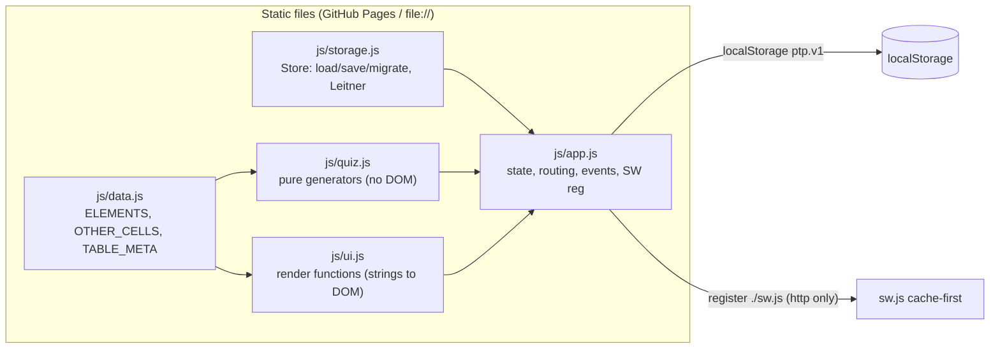
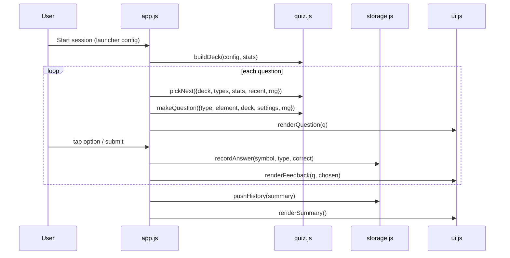

# Periodic Table Practice PWA: Implementation Plan (handoff-ready)

## Goal

Build the mobile-first, offline, installable **Periodic Table Practice** web app described in [AGENT_PROMPT.md](file:///home/mushfiq/Desktop/periodic_practice/docs/AGENT_PROMPT.md). It uses vanilla HTML, CSS and JS, with no build step, and is deployable on GitHub Pages. The deck is the 59 essential elements in [data.js](file:///home/mushfiq/Desktop/periodic_practice/data.js). Some *derived* masses get replaced by the **school values** from [hsc_physics_chemistry_constants.json](file:///home/mushfiq/Desktop/periodic_practice/hsc_physics_chemistry_constants.json) (`common_hsc_atomic_masses[].relative_atomic_mass_school`).

This document is the **single source of truth** for whoever implements it, human or AI. In step M0 it is copied into the repo as `docs/IMPLEMENTATION_PLAN.md`, next to `docs/PROGRESS.md`. Anyone taking over reads those two files plus `docs/AGENT_PROMPT.md`, then resumes at the first unchecked milestone.

---

## User Review Required

> [!IMPORTANT]
> **Mass-data rule (agreed with the user, 2026-11-22)**
> 1. `massSource: "user"` values (27) are **kept exactly as in data.js**, even where the JSON differs (K 39.1, Mn 54.93, Fe 55.85, Ni 58.7, **Zn 65.4**, As 74.9, Hg 200.5).
> 2. `massSource: "derived"` elements that appear in the JSON get `atomicMass = relative_atomic_mass_school` and `massSource = "school"`.
> 3. Derived elements **not** in the JSON keep their data.js value and stay `"derived"` (shown as "unverified").
> 4. This is applied **once** by a script that patches data.js (the user approved this). After that, data.js is frozen again.

> [!WARNING]
> This deliberately deviates from AGENT_PROMPT.md §0 ("Do not edit any value in data.js"). AGENT_PROMPT.md gets updated in M0 so that the next agent doesn't "fix" it back.

### Resulting mass table (computed from the actual files)

| Group | Count | Elements |
|---|---|---|
| `user` (unchanged) | 27 | H 1, C 12, N 14, O 16, Na 23, Mg 24, Al 27, P 31, S 32, Cl 35.5, K 39.1, Ca 40, Cr 52, Mn 54.93, Fe 55.85, Co 59, Ni 58.7, Cu 63.5, Zn 65.4, As 74.9, Br 80, Ag 108, I 127, Ba 137, Au 197, Hg 200.5, Pb 207 |
| `school` (new) | 12 | He 4, Li 7, Be 9, B 11, F 19, Ne 20, Si 28, Ar 40, Se 79, **Sn 119** (was 118.7), Pt 195, U 238 |
| `derived` (unverified) | 20 | Sc 45, Ti 48, V 51, Ga 69.7, Ge 72.6, Kr 84, Rb 85.5, Sr 87.6, Mo 96, Pd 106.4, Cd 112.4, Sb 121.8, Te 127.6, Xe 131.3, Cs 133, La 139, Bi 209, Rn 222*, Ac 227*, Th 232 |

Only **Sn** changes numerically. The other 11 keep the same number and are now marked as verified against the school reference. `*` = `massIsApprox`.

> [!NOTE]
> **Data hazard found:** Ar and Ca both have exam mass **40**. The `mass→symbol` and `symbol→mass` generators must never offer a distractor whose exam mass equals the correct one. This is covered by a dedicated test.

## Open Questions

None blocking. Defaults I chose (any of these can be changed later):
- Detail-sheet badge for `school` masses: a subtle "HSC school ref." caption. Only `derived` gets the dotted "unverified" marker.
- `hsc_physics_chemistry_constants.json` stays at the repo root as a source file. It is **not** loaded at runtime and **not** precached (it is 130 KB).
- Settings defaults: 4 options, HSC block rules ON, classical groups OFF, mass display "both", auto-advance OFF, haptics ON, theme auto.

---

## Architecture



Script load order in `index.html` (all `defer`, **no ES modules**): `data.js → storage.js → quiz.js → ui.js → app.js`. Each file exposes **one** global namespace (`window.Store`, `window.Quiz`, `window.UI`) and `app.js` owns `state`.



---

## Proposed Changes

### Final repository layout

```
/
├─ index.html  manifest.webmanifest  sw.js  .nojekyll  README.md  tests.html
├─ hsc_physics_chemistry_constants.json      # source only, not shipped to the SW cache
├─ css/style.css
├─ js/data.js storage.js quiz.js ui.js app.js
├─ icons/icon.svg icon-192.png icon-512.png icon-maskable-512.png apple-touch-icon.png
├─ tests/assertions.js        # shared by tests.html and the Node runner
├─ tests/run-node.js          # node tests/run-node.js  (dev only)
├─ tools/apply_school_masses.js  # one-shot data patch (idempotent, has --check)
├─ tools/make-icons.sh        # rsvg-convert SVG to PNGs
└─ docs/AGENT_PROMPT.md  IMPLEMENTATION_PLAN.md  PROGRESS.md
```

`tests/`, `tools/` and `docs/` are dev-only. They are not referenced by the app and not precached.

---

### M0: Repo bootstrap and data patch

#### Git
- `git add -A && git commit -m "chore: import source data and agent prompt"` (the repo currently has no commits).
- `git mv data.js js/data.js`

#### [NEW] tools/apply_school_masses.js
This is a text-level patch, so data.js formatting and comments stay byte-identical except for the changed fields.

```js
#!/usr/bin/env node
// Usage: node tools/apply_school_masses.js [--check]
// Rule: only massSource "derived" elements present in the JSON are changed:
//   atomicMass <- relative_atomic_mass_school, massSource <- "school".
// "user" values are never touched. Idempotent.
const fs = require('fs'), path = require('path');
const root = path.resolve(__dirname, '..');
const dataPath = path.join(root, 'js', 'data.js');
const json = JSON.parse(fs.readFileSync(path.join(root, 'hsc_physics_chemistry_constants.json'), 'utf8'));
const school = new Map(json.common_hsc_atomic_masses.map(r => [r.symbol, Number(r.relative_atomic_mass_school)]));
const check = process.argv.includes('--check');
let src = fs.readFileSync(dataPath, 'utf8');
const changes = [];
src = src.replace(/^  \{"atomicNumber".*$/gm, line => {
  const el = JSON.parse(line.trim().replace(/,$/, ''));
  if (el.massSource !== 'derived' || !school.has(el.symbol)) return line;
  const v = school.get(el.symbol);
  changes.push(`${el.symbol}: ${el.atomicMass} -> ${v}`);
  return line
    .replace(/"atomicMass": [0-9.]+,/, `"atomicMass": ${v},`)   // does not match "atomicMassPrecise"
    .replace('"massSource": "derived"', '"massSource": "school"');
});
// recount and rewrite TABLE_META counts
const count = s => (src.match(new RegExp(`"massSource": "${s}"`, 'g')) || []).length;
src = src.replace(/"userMassCount": \d+,\s*\n\s*("schoolMassCount": \d+,\s*\n\s*)?"derivedMassCount": \d+/,
  `"userMassCount": ${count('user')},\n  "schoolMassCount": ${count('school')},\n  "derivedMassCount": ${count('derived')}`);
if (check) { console.log(changes.length ? 'PENDING:\n' + changes.join('\n') : 'OK: nothing to change'); process.exit(changes.length ? 1 : 0); }
fs.writeFileSync(dataPath, src);
console.log(`Applied ${changes.length} change(s):\n` + changes.join('\n'));
```

Also update the header comment of data.js (by hand, a comment-only change) to document `"school"`:
```diff
- *   massSource         : "user"    = taken as-is from Jishan's own collected HSC/admission list (27 elements)
+ *   massSource         : "user"    = taken as-is from Jishan's own collected HSC/admission list (27 elements)
+ *                        "school"  = derived value replaced by the HSC school value from
+ *                                    hsc_physics_chemistry_constants.json (12 elements; via tools/apply_school_masses.js)
```

**Expected output:** 12 changes, with Sn the only numeric change (118.7 → 119). TABLE_META ends up as `user 27 / school 12 / derived 20`. A second run with `--check` prints `OK`.

#### [MODIFY] docs/AGENT_PROMPT.md
- §0: `massSource ("user" | "school" | "derived")`. Note that data.js was patched once by `tools/apply_school_masses.js` and must not be edited further.
- Line 15: "27 user, 12 school, 20 derived. The unverified marker is shown **only** for `derived`."
- §9: add the 12 school values and the sentence "User values win over the JSON (e.g. Zn stays 65.4)".
- §5 tests: add "the 12 `school` masses equal the JSON `relative_atomic_mass_school`".
- Layout: data.js lives at `js/data.js`; add `tests/`, `tools/`, `docs/`.

#### [NEW] docs/IMPLEMENTATION_PLAN.md (a copy of this document) and docs/PROGRESS.md

`PROGRESS.md` template: a milestone checklist (M0–M7), a "Decisions log" (the mass rule, the Ar/Ca hazard, deviations) and a "Next step" line. **Every agent updates it before each commit.**

Commit: `feat(data): apply HSC school masses to derived elements`

---

### M1: Skeleton, Table screen and detail sheet

#### [NEW] index.html
- Meta tags: `viewport` (with `viewport-fit=cover`), two `theme-color` tags (light and dark media), `apple-mobile-web-app-capable`, `apple-mobile-web-app-status-bar-style=default`, `<link rel="apple-touch-icon" href="icons/apple-touch-icon.png">`, `<link rel="manifest" href="manifest.webmanifest">`. **Relative paths only.**
- Body: `<header id="topbar">`, `<main id="view" aria-live="off">`, `<div id="sheet" role="dialog" aria-modal="true" hidden>` (bottom sheet + backdrop), `<div id="toast" role="status" aria-live="polite">`, `<nav id="tabs">` with 4 `<button data-tab="table|practice|review|settings">` items, each with an inline SVG icon and a label.
- `<noscript>` message.

#### [NEW] css/style.css (target ≤ 14 KB)
- `:root` tokens: `--bg --surface --text --muted --accent --ok --bad --border --radius --gap`, one variable per category colour (10 categories: reactive-nonmetal, noble-gas, alkali-metal, alkaline-earth-metal, metalloid, halogen, post-transition-metal, transition-metal, lanthanoid, actinoid), plus a dark set under `@media (prefers-color-scheme: dark)` and `[data-theme=dark|light]` overrides.
- Global rules: `* {box-sizing:border-box}`, `html,body {touch-action:manipulation; -webkit-tap-highlight-color:transparent}`, a system font stack, an `#app` column `max-width:520px; margin:auto; min-height:100dvh`.
- Tab bar: `position:fixed; bottom:0`, `padding-bottom:env(safe-area-inset-bottom)`, buttons at least 56 px tall.
- Periodic grid: `.pt {display:grid; grid-template-columns:repeat(18,1fr); gap:1px}`. Tiles use `aspect-ratio:1`, font 9–10 px and `user-select:none`. `.pt.zoom2 {width:200%}` sits inside an `overflow-x:auto` wrapper; the page itself never scrolls horizontally. Row 8 is the spacer (`height:6px`).
- Options grid: `.opts {display:grid; grid-template-columns:1fr 1fr; gap:10px}`, `.opt {min-height:52px}`. The quiz layout is a flex column with `.opts` pushed down using `margin-top:auto` (thumb zone).
- States: `.opt.correct` / `.opt.wrong` use colour **plus** an icon prefix (`✓` / `✗` through a `::before` with `content`), plus a text label in the feedback card.
- `:focus-visible` outline, `@media (prefers-reduced-motion:reduce) {*{transition:none!important; animation:none!important}}`, transitions at most 150 ms.

#### [NEW] js/ui.js: rendering only (`window.UI`)
- `UI.table({show, zoom, legend, settings})`: builds one string for 118 tiles plus 2 series placeholders, and sets `innerHTML` once.
  - Essential tile: `<button class="tile cat-transition-metal" data-sym="Cu" aria-label="Copper, atomic number 29" style="grid-row:4;grid-column:11">Cu</button>`. Shows the symbol, `atomicNumber` or `atomicMass`, depending on `show`.
  - Other tile: `<div class="tile dim" aria-hidden="true" style="...">Y</div>` (not tappable).
  - The toggle `Show: symbols | numbers | masses` is a segmented control, followed by the zoom 1×/2× button and the legend toggle.
- `UI.detail(el, settings)`: content of the bottom sheet:
  - Name, symbol and Z.
  - Period.
  - Group: `11 / IB`, or "Lanthanoid series" / "Actinoid series" when `iupacGroup === null` (category tells which).
  - Block: when HSC rules are ON, show `hscBlock`, plus the note "d-block in HSC (f-block in modern IUPAC)" for La, Ac and Th. When OFF, show `block`.
  - Mass per the `massDisplay` setting:
    - `exam`: show `atomicMass`.
    - `precise`: show `atomicMassPrecise`.
    - `both`: show both.
  - Mass markers: `derived` gets `<abbr class="unverified" title="Not in your list; double-check against NCTB table">` with a dotted underline and a footnote "† unverified". `school` gets the caption "HSC school ref.". `massIsApprox` gets "mass number of longest-lived isotope".
  - `examTags` as chips (`aufbau-exception` → "Aufbau exception").
- Helpers: `esc()` (HTML-escape everything interpolated), `fmtMass(n) = String(n)` (stored form, no forced decimals), `groupLabel(el, showClassical)`, `catLabel`.

#### [NEW] js/app.js (skeleton)
- A single `state = {tab, settings, store, session:null, sheetSym:null}`.
- `route()` runs on `hashchange` and maps `#table|#practice|#review|#settings` to `render()`. The default is `#table`.
- **Event delegation:** one `click` listener on `#view`, one on `#tabs`, one on `#sheet`, and one `keydown` listener on `document`. Dispatch is driven by `data-action` / `data-sym` attributes.
- `openSheet(sym)` / `closeSheet()`: the sheet closes on backdrop tap, the close button, or Esc. Focus moves into the sheet and returns to the tile afterwards.

**Verify:** at 360 px, `document.documentElement.scrollWidth <= 360` on every tab.
Commit: `feat: app skeleton, table screen and detail sheet`

---

### M2: quiz.js generators and tests (generators first, UI after)

#### [NEW] js/quiz.js: pure functions, no DOM (`window.Quiz`)

```js
Quiz.TYPES = ['symbol-name','name-symbol','number-symbol','symbol-number','number-name',
              'symbol-period','symbol-group','symbol-mass','mass-symbol','cell-element','element-position'];
Quiz.TOPICS = {           // launcher chips -> types
  names:    ['symbol-name','name-symbol'],
  numbers:  ['number-symbol','symbol-number','number-name'],
  position: ['symbol-period','symbol-group','element-position'],
  mass:     ['symbol-mass','mass-symbol'],
  cell:     ['cell-element'] };
Quiz.TYPING_TYPES = ['symbol-name','name-symbol','number-symbol','symbol-number','symbol-mass'];
Quiz.rng(seed)              // mulberry32; Math.random is the default in app
Quiz.makeQuestion({type, element, deck, settings, rng})
  // -> {id, type, symbol, prompt, promptExtra, options[], correctIndex, explain}
  // element is optional (picked at random from deck if absent) and keeps the spec signature compatible.
Quiz.pickNext({deck, types, stats, recent, used, rng}) -> {element, type}
Quiz.checkTyped(type, element, input) -> {correct, canonical}
Quiz.buildDeck({filter, tag, weakOnly, symbols}, stats) -> element[]
```

**Distractor algorithm.** Let `k = settings.optionCount - 1` (3 or 5). `pool` is the deck, falling back to all 59 elements when the deck is too small to fill `k` unique options. All options are de-duplicated by **display string**, shuffled with `rng`, and `correctIndex` is recomputed after the shuffle.

| Type | Prompt → answer | Distractors |
|---|---|---|
| symbol-name / name-symbol / number-symbol / number-name | element → symbol or name | Up to ⌈k/2⌉ from **lookalikes**, chosen in this priority: a hard-coded set list `[[Co,Cu,Cr,Cs,Ca,Cd,C,Cl],[Sn,Sb,Si,S,Se,Sc,Sr],[Pt,Pd,Pb,P],[Ag,Au,As,Al,Ar,Ac],[Na,Ne,Ni,N],[Mg,Mn,Mo],[Ti,Te,Th],[B,Be,Ba,Bi,Br],[K,Kr],[Ga,Ge],[Rb,Rn],[Xe],[Hg,H,He]]`, then shared first letter. The rest come from **same group** or **same-period neighbours** (\|ΔZ\| ≤ 3). Fill randomly if still short. |
| symbol-number | symbol → Z | Unique `Z + d`, with d ∈ ±1…±6, clipped to 1–118 |
| symbol-period | → `Period n` | Nearest other periods within 1–7 (6 available, so 6 options always work) |
| symbol-group | → `Group g` (+ ` (IB)` when showClassical) | Neighbouring IUPAC groups 1–18. **f-series (La/Ac/Th/U):** the correct answer is "Lanthanoid series" (La) or "Actinoid series" (Ac/Th/U). Options **always include both series**, and the remaining k−1 are groups 3, 4, 2, 5… |
| symbol-mass | → exam mass string | Exam masses of other pool elements within ±15%, nearest first. Then `correct ± step·n` (step 1, or 0.5 if the value ends in .5, or 0.1 for 1 decimal, or 0.01 for 2). **Reject** any value v with \|v − atomicMass\| < 0.3, or \|v − atomicMassPrecise\| < 0.3, or v ≤ 0. This guarantees Cl never shows 35.45, Cu never 63.55, Zn never 65.38, and Ar never shows Ca's 40. |
| mass-symbol | mass → symbol | Pool elements with the nearest exam masses, **excluding any with an equal exam mass** (Ar/Ca), mixed with 1 random element |
| cell-element | `promptExtra = {gridRow, gridCol}` → symbol | Grid-adjacent essential elements (Manhattan distance ≤ 2), then lookalikes, then random |
| element-position | → `Period 4, Group 11` | Combinations of period ±1 and group ±1/±2. For the f-series: `Period 6, Lanthanoid series`, `Period 7, Actinoid series`, `Period 7, Group 3`, … |

`explain` example: `"Cu (Copper) is in period 4, group 11 (IB), transition metal; exam mass 63.5."` For the f-series it reads "…period 7, Actinoid series…".

**Leitner selection (`pickNext`).**
1. Pick `type` uniformly from the enabled types.
2. Candidates = deck minus the `recent` 5 symbols, minus symbols already `used` this session. When nothing is left, reset `used` (this allows repeats only once the deck is exhausted).
3. Weighted random by box (`box1 → 3`, `box2 → 2`, `box3 → 1`, unseen counts as box 1).

**Typing (`checkTyped`).**
- Name and symbol answers: compare with `trim().toLowerCase()` against `name`, `symbol` and `alternateNames`.
- Number answers: integer equality.
- Mass answers: `parseFloat`, correct if `== atomicMass` or `|x − atomicMassPrecise| ≤ 0.15`. (Sn: 119 is the exam value, and 118.7 is also accepted through the precise value.)
- The result returns the canonical answer for display.

#### [NEW] tests/assertions.js, tests/run-node.js, tests.html
`assertions.js` exports `runAll(ELEMENTS, OTHER_CELLS, TABLE_META, Quiz, SCHOOL)`, which returns `[{name, ok, detail}]`. `SCHOOL` is the expected 12-value table, inlined so the browser runs need no fetch. The Node runner loads data.js and quiz.js through `vm`, with `window = globalThis`, and also cross-checks `SCHOOL` against the JSON file.

Assertions:
1. 59 elements; unique Z; 118 unique grid cells across ELEMENTS + OTHER_CELLS; no element on row 8.
2. The 27 `user` masses equal AGENT_PROMPT §9 exactly; the 12 `school` masses equal the JSON; there are exactly 20 `derived`; TABLE_META counts match.
3. For every type × optionCount {4, 6} × 500 seeded questions: unique options, `options.length === optionCount`, exactly one correct, and `options[correctIndex]` matches the element's ground truth.
4. Mass types: no distractor equals or is within 0.3 of `atomicMass` or `atomicMassPrecise`. `mass-symbol` never offers a second element with the same exam mass (Ar/Ca).
5. f-series group questions: both series options are present and the correct one is marked.
6. `checkTyped`: "sulphur", "Aluminum", " CU " are accepted; Cl 35.45 and Cl 35.5 are accepted; Cl 36 is rejected; Zn 65.4 is accepted, and 65 is rejected (it is outside ±0.15 of 65.38, and the user value wins).
7. `pickNext`: in a 10-question run on 59 elements there are no duplicates, and no symbol repeats within any window of 5.

`tests.html` renders a pass/fail list and sets `document.body.dataset.result = 'pass' | 'fail'` so headless runs can grep it. When it is served over http, it also runs a **layout check**: it loads `index.html` into a 360 × 780 iframe, visits every tab and an MCQ question at 4 and 6 options, and asserts that `scrollWidth ≤ clientWidth` and every `.opt` / tab button is at least 44 px tall.

Commit: `feat: pure question generators with seeded tests`

---

### M3: MCQ mode UI

- **Launcher** (`UI.launcher(cfg)`):
  - Mode segmented control: MCQ / Position / Typing.
  - Topic chips (`aria-pressed`).
  - Deck select: All 59 / Weak (box 1) / Tag, with a `<select>` built from the 16 `examTags`.
  - Length: 10 / 20 / 40 / ∞.
  - A large Start button.
  - The config persists in `settings.launcher`. If the deck is empty, Start is disabled and the screen shows "No elements match".
- **Question screen:**
  - Top: progress `7 / 20`, streak 🔥, and a 3 px progress bar.
  - Middle: the prompt (big symbol or name), plus a mini 18-column grid for `cell-element` that highlights one cell, reusing the `.pt` styles with tiny dots.
  - Bottom: `.opts` in 2 × 2 (4 options) or 2 × 3 (6), as `<button class="opt" data-action="answer" data-i="n">`.
- **Feedback:**
  - The chosen option gets `.wrong ✗` and the correct one `.correct ✓`; all options are disabled.
  - The explanation card shows "Correct!" or "Not quite — answer: X" plus `explain`, in an `aria-live="polite"` region.
  - Wrong answers call `navigator.vibrate?.(30)` when haptics are on.
  - A large Next button. Auto-advance runs after 1200 ms when enabled; the timer is cleared on tab change.
- **Keyboard:** keys `1`–`6` answer and `Enter` moves to Next. They are only active on the practice tab while a question is shown, and are ignored when the focus is in an input.
- **Summary:** score, accuracy, a list of missed elements with their correct answers, and the buttons "Again", "Drill missed" and "Back".

Commit: `feat: MCQ practice mode with 4/6 options and feedback`

### M4: Position and Typing modes

- **Position:**
  - Step 1: period buttons 1–7.
  - Step 2: group buttons 1–18 in 2 rows of 9, plus 2 wide buttons "Lanthanoid series" / "Actinoid series".
  - Correct only if both parts are right; the feedback names the wrong part ("Period ✓, Group ✗ — it's 11").
  - The Leitner type is `element-position`.
  - About 30% of questions use the reverse variant (`cell-element` MCQ).
- **Typing:**
  - Uses the `TYPING_TYPES` filtered by the enabled topics.
  - `<input>` uses `inputmode="decimal"` for numbers and masses and `inputmode="text"` with `autocapitalize="off"` / `autocomplete="off"` / `spellcheck="false"` otherwise. Enter submits.
  - Feedback shows the canonical spelling. For mass answers it shows "exam 63.5 · precise 63.55".

Commit: `feat: position and typing modes`

### M5: Storage, Leitner, Review and Settings

#### [NEW] js/storage.js (`window.Store`)

```js
const KEY = 'ptp.v1', VERSION = 1;
// shape: {version, stats:{[sym]:{seen, correct, boxes:{[type]:1|2|3}}}, history:[{t, mode, topics, n, correct}], settings:{...}, bestStreak}
Store.load()      // try/catch JSON.parse; on failure or unavailable storage -> defaults (in-memory)
Store.save(data)  // try/catch; returns false silently if storage is unavailable
Store.migrate(d)  // switch on d.version; stub: v1 -> v1, unknown -> defaults merged
Store.record(data, sym, type, ok) -> new data (immutable update: box up max 3 / reset to 1)
Store.pushHistory(data, entry)    -> new data, keeps the last 10
Store.exportText(data) / Store.importText(text) -> {ok, data|error}  // validates version and shape
```

- **Review screen:**
  - Overall accuracy, questions answered and best streak.
  - Weak list: sorted by min box, then accuracy, top 10, with a "Drill weak ones" button that starts an MCQ session on exactly those symbols.
  - A per-element table (symbol, seen, accuracy %, min box). Tapping a row opens the detail sheet.
  - The last 10 sessions.
- **Settings screen:**
  - Every setting from AGENT_PROMPT §3.4.
  - Theme writes `document.documentElement.dataset.theme`.
  - Reset asks for `confirm()`.
  - Export fills a read-only textarea and adds a Copy button using `navigator.clipboard`, with a select-all fallback. Import pastes into a textarea and validates before applying.
  - Version row, plus an "Update available → Reload" row when the service worker has an update.

Commit: `feat: leitner storage, review and settings screens`

### M6: PWA, icons and README

- **[NEW] icons/icon.svg:** a rounded square tile in a calm teal with a bold "Pt" and a small "78" top-left. **[NEW] tools/make-icons.sh:** runs `rsvg-convert` to produce 192, 512 and 180 (apple) sizes, plus a maskable 512 rendered from an SVG variant with a 20% safe-zone padding and a full-bleed background. PNGs get optimised with `magick -strip`. rsvg-convert, Inkscape and ImageMagick are all available locally.
- **[NEW] manifest.webmanifest:** name "Periodic Table Practice", short_name "PT Practice", `start_url:"./"`, `scope:"./"`, `display:"standalone"`, `orientation:"portrait"`, colours, and 3 icons (one with `purpose:"maskable"`).
- **[NEW] sw.js:**
```js
const VERSION = 'v1.0.0'; const CACHE = 'ptp-' + VERSION;
const ASSETS = ['./','./index.html','./css/style.css','./js/data.js','./js/storage.js','./js/quiz.js',
  './js/ui.js','./js/app.js','./manifest.webmanifest','./icons/icon.svg','./icons/icon-192.png',
  './icons/icon-512.png','./icons/icon-maskable-512.png','./icons/apple-touch-icon.png'];
// install: caches.open(CACHE).then(c => c.addAll(ASSETS))   (no skipWaiting here)
// activate: delete keys starting with 'ptp-' !== CACHE; clients.claim()
// fetch (GET, same-origin): navigate -> caches.match('./index.html') fallback; else cache-first then network
// message: if (e.data === 'SKIP_WAITING') self.skipWaiting()
```
- **Registration** in app.js: only when `'serviceWorker' in navigator && location.protocol.startsWith('http')`, inside try/catch. On `updatefound` → `installed` with an existing `controller`, show a toast and a Settings row "New version available. Reload" that posts `SKIP_WAITING`. A `controllerchange` event triggers a single `location.reload()`.
- **[NEW] .nojekyll** (empty) and **README.md**: what the app is, the deploy steps (Settings → Pages → main / root), install steps for Android and iOS, the offline checklist, "bump VERSION in sw.js to ship updates", and a note on the mass rule.

Commit: `feat: installable offline PWA with icons and README`

### M7: Final pass
- Run all automated checks (below). Check contrast for text and tile colours: at least 4.5:1 for text, computed by a small helper in tests.html for the token pairs. Check the size budget. Run Lighthouse if available (`npx lighthouse` needs network, so it is optional).
- Write the final report into `docs/PROGRESS.md` and the walkthrough artifact: what was built, deviations (data.js patch, `tests/` + `tools/` directories, JSON kept at the root) and assumptions.

Commit: `chore: final QA pass`

---

## Size budget (excluding data.js)

| File | Target |
|---|---|
| index.html | ≤ 4 KB |
| css/style.css | ≤ 14 KB |
| js/storage.js + quiz.js + ui.js + app.js | ≤ 36 KB total |
| sw.js + manifest | ≤ 2 KB |
| **Code subtotal** | **≤ 56 KB** |
| icons (PNG + SVG) | ≤ 30 KB, reported separately |

Check: `du -cb index.html css/*.css js/{storage,quiz,ui,app}.js sw.js manifest.webmanifest | tail -1`

---

## Verification Plan

### Automated tests
```bash
cd /home/mushfiq/Desktop/periodic_practice
node tools/apply_school_masses.js --check          # expect "OK: nothing to change"
node tests/run-node.js                              # all assertions, exit code 0
python3 -m http.server 8765 &                       # serve for SW + iframe layout check
chromium --headless=new --disable-gpu --virtual-time-budget=15000 \
  --dump-dom http://localhost:8765/tests.html | grep -o 'data-result="[a-z]*"'   # expect pass
for t in table practice review settings; do
  chromium --headless=new --disable-gpu --hide-scrollbars --window-size=360,780 \
    --screenshot=/tmp/ptp-$t.png "http://localhost:8765/index.html#$t"; done
grep -rnE "(src|href)=\"/" index.html; grep -n "fetch(" js/*.js   # both must be empty
```
Screenshots are copied into the artifact directory and embedded in the walkthrough. Each milestone ends with `node tests/run-node.js` passing before its commit.

### Manual verification (user, on phone)
1. Open the deployed `https://<user>.github.io/<repo>/` → Install app (Chrome Android: menu → Install app; Safari iOS: Share → Add to Home Screen).
2. Turn on airplane mode, relaunch, check that all four tabs work and progress persists.
3. Run an MCQ session with 6 options and check that the buttons are comfortable to reach with one thumb.
4. Open the detail sheets for Sn (119, school ref.), Zn (65.4, no marker), Ga (69.7, unverified †) and La (Lanthanoid series, HSC d-block note).
5. Export the progress, Reset, Import it again, and check that the stats are restored.

---

## Handoff protocol (for any AI taking over)
1. Read `docs/PROGRESS.md` → find the first unchecked milestone and the "Next step" line.
2. Read `docs/AGENT_PROMPT.md` (product spec) and `docs/IMPLEMENTATION_PLAN.md` (this design). If they conflict, **this plan and the Decisions log win**, because they record later user decisions.
3. Never edit mass values in `js/data.js` by hand. Never change `user` values.
4. Run `node tests/run-node.js` before you start (it should be green for the completed milestones) and again before every commit.
5. Use conventional commits, one per milestone, and update PROGRESS.md in the same commit.
